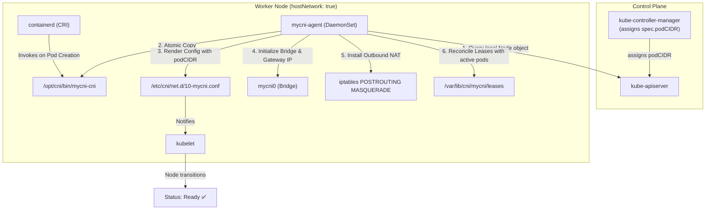
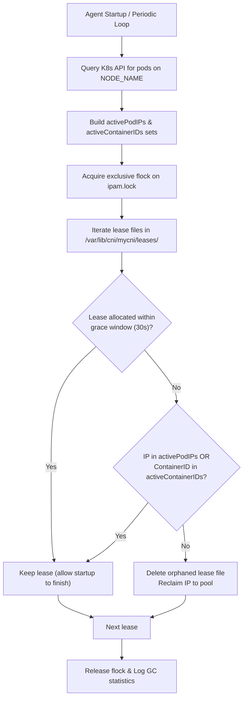

# Milestone 2 (M2): DaemonSet Node Agent, Automated Bootstrapping, and IPAM Hardening

> *"In Milestone 1, we proved that container networking is just standard Linux netlink calls. In Milestone 2, we turn a collection of manual steps into a fully automated, production-grade Kubernetes networking system that bootstraps across every node in the cluster with zero manual intervention."*

This document walks through **Milestone 2 (M2)** of **MyCNI**. It explains why node daemons are essential in Kubernetes networking, how `mycni-agent` bootstraps nodes dynamically using the Downward API and `client-go`, how IPAM is hardened against race conditions and leaked leases, how kernel datapaths and sysctls are maintained, and how to explain the entire system naturally in an interview.

---

## Table of Contents

1. [The Big Picture: Why Do We Need a Node Agent?](#1-the-big-picture-why-do-we-need-a-node-agent)
2. [Architecture & Node Bootstrapping Sequence](#2-architecture--node-bootstrapping-sequence)
   - [2.1 The Downward API & Node Discovery](#21-the-downward-api--node-discovery)
   - [2.2 Atomic Asset Installation & The Rename Pattern](#22-atomic-asset-installation--the-rename-pattern)
   - [2.3 Dynamic CNI Configuration Generation](#23-dynamic-cni-configuration-generation)
   - [2.4 Host Dataplane & Sysctl Enforcement](#24-host-dataplane--sysctl-enforcement)
3. [IPAM Hardening & Garbage Collection](#3-ipam-hardening--garbage-collection)
   - [3.1 Lease Metadata & Backward Compatibility](#31-lease-metadata--backward-compatibility)
   - [3.2 Startup & Periodic Lease Reconciliation Algorithm](#32-startup--periodic-lease-reconciliation-algorithm)
   - [3.3 Concurrency & Lock Contention under High Churn](#33-concurrency--lock-contention-under-high-churn)
4. [Kubernetes Manifests & DaemonSet Privilege Model](#4-kubernetes-manifests--daemonset-privilege-model)
5. [Scale & Concurrency Stress Testing (30 Replicas)](#5-scale--concurrency-stress-testing-30-replicas)
6. [Zero-Downtime Agent Restarts](#6-zero-downtime-agent-restarts)
7. [The Trial-and-Error Gotchas (Real Debugging Stories)](#7-the-trial-and-error-gotchas-real-debugging-stories)
   - [Story 1: The Missing `br_netfilter` Sysctl & CrashLooping CoreDNS](#story-1-the-missing-br_netfilter-sysctl--crashlooping-coredns)
   - [Story 2: The `ETXTBSY` / Partial Binary Execution Race](#story-2-the-etxtbsy--partial-binary-execution-race)
   - [Story 3: Xtables Lock Contention during Kube-Proxy Syncs](#story-3-xtables-lock-contention-during-kube-proxy-syncs)
8. [How to Explain M2 in an Interview (2-Minute Script)](#8-how-to-explain-m2-in-an-interview-2-minute-script)

---

## 1. The Big Picture: Why Do We Need a Node Agent?

In **Milestone 1**, we manually copied `mycni-cni` to `/opt/cni/bin/` on `mycni-worker`, wrote `/etc/cni/net.d/10-mycni.conf`, and ran `iptables` commands by hand.

While that proved our CNI binary worked, it had fatal flaws for production:
1. **Manual intervention per node:** In a 100-node or autoscaling cluster, you cannot manually SSH or `docker cp` onto every node.
2. **Nodes stuck in `NotReady`:** When kubelet starts on a new node, it checks `/etc/cni/net.d/` for a valid CNI configuration. If none exists, kubelet marks the node `NotReady` and refuses to schedule non-daemon workloads.
3. **Leaked IP leases from crashed sandboxes:** If a node reboots, the kubelet crashes, or containerd terminates abruptly while creating a pod sandbox, CNI `DEL` is never called. Without an active reconciler, those IPs stay leased forever, eventually causing IP exhaustion.
4. **Drift in kernel state:** Docker, kube-proxy, or node restarts can flush iptables chains or reset sysctls.

In **Milestone 2**, we solve this by introducing `mycni-agent`, a long-running Kubernetes `DaemonSet` deployed to `kube-system`.



---

## 2. Architecture & Node Bootstrapping Sequence

### 2.1 The Downward API & Node Discovery
When `mycni-agent` starts inside a container, how does it know which physical/virtual node it is running on?
We use the **Kubernetes Downward API**:

```yaml
env:
  - name: NODE_NAME
    valueFrom:
      fieldRef:
        fieldPath: spec.nodeName
```

On startup, `mycni-agent` reads `NODE_NAME` and queries `kube-apiserver`:

```go
node, err := k8sClient.CoreV1().Nodes().Get(ctx, nodeName, metav1.GetOptions{})
```

From `node.Spec.PodCIDR` (or `node.Spec.PodCIDRs[0]`), the agent learns the exact subnet carved out for this node (e.g., `10.244.0.0/24` for control-plane, `10.244.1.0/24` for worker, `10.244.2.0/24` for worker2). If `kube-controller-manager` has not finished assigning `podCIDR` yet, the agent retries with exponential backoff until it becomes available.

---

### 2.2 Atomic Asset Installation & The Rename Pattern
The agent image packages `/bin/mycni-cni`. The host's `/opt/cni/bin` is mounted into the container at `/host/opt/cni/bin`.

If the agent were to write directly to `/host/opt/cni/bin/mycni-cni` with `io.Copy`, a simultaneous pod scheduling event could cause `containerd` to execute the file while it is only half-written. The Linux kernel will return `ETXTBSY` ("text file busy") or containerd will fail with an invalid ELF header.

To prevent this, `mycni-agent` implements the **Atomic Rename Pattern**:
1. Copy `/bin/mycni-cni` to a temporary hidden file in the destination filesystem: `/host/opt/cni/bin/.mycni-cni.tmp.<pid>`.
2. Explicitly `chmod 0755` the temporary file.
3. Call `os.Rename(tmpFile, dstFile)`. In POSIX filesystems, `rename()` within the same filesystem is guaranteed to be an atomic directory entry swap. `containerd` either executes the old binary or the new binary, never a partially-written file.

---

### 2.3 Dynamic CNI Configuration Generation
Once `spec.podCIDR` is known, `mycni-agent` renders `/host/etc/cni/net.d/10-mycni.conf`:

```json
{
  "cniVersion": "1.0.0",
  "name": "mycni",
  "type": "mycni-cni",
  "bridge": "mycni0",
  "mtu": 1500,
  "podCIDR": "10.244.2.0/24",
  "dataDir": "/var/lib/cni/mycni"
}
```

This write is also performed via the atomic temporary file + `os.Rename` pattern. As soon as kubelet's inotify watcher detects the valid CNI configuration in `/etc/cni/net.d/`, the node transitions from `NotReady` to `Ready`.

---

### 2.4 Host Dataplane & Sysctl Enforcement
`mycni-agent` ensures the node's network stack is ready before any pod starts:
1. **Bridge Interface (`mycni0`):** Creates the Linux bridge if missing, assigns the gateway IP (first usable IP in the subnet, e.g. `10.244.2.1/24`), sets the MTU (1500), and brings the interface `UP`.
2. **Outbound NAT (`iptables` MASQUERADE):**
   ```bash
   iptables -t nat -A POSTROUTING -s <nodePodCIDR> ! -d <clusterCIDR> -j MASQUERADE
   ```
   Ensures egress traffic toward external networks or other subnets is SNATed to the node's primary interface IP while avoiding double-NAT for cluster-internal traffic.
3. **Kernel Sysctls:**
   - `net.ipv4.ip_forward = 1`: Allows Linux kernel to route packets between pod namespaces and host interfaces.
   - `net.bridge.bridge-nf-call-iptables = 1`: Forces bridged traffic through iptables FORWARD chains (mandatory for `kube-proxy` service routing and NetworkPolicy).

---

## 3. IPAM Hardening & Garbage Collection

### 3.1 Lease Metadata & Backward Compatibility
In M1, IP leases were stored simply as:
```text
<containerID>
<ifName>
```
In M2, we upgraded the lease storage to track rich Kubernetes metadata while preserving 100% backward compatibility:
```text
<containerID>
<ifName>
<podNamespace>
<podName>
<allocatedAt_RFC3339>
```

When reading a lease file:
- If lines 3–5 are missing (M1 legacy lease), defaults are applied smoothly.
- If lines 3–5 exist, the agent and debugging tools have full insight into the exact pod name and allocation timestamp.

```go
type Lease struct {
    IP           net.IP    `json:"ip"`
    ContainerID  string    `json:"containerID"`
    IfName       string    `json:"ifName"`
    PodNamespace string    `json:"podNamespace,omitempty"`
    PodName      string    `json:"podName,omitempty"`
    AllocatedAt  time.Time `json:"allocatedAt,omitempty"`
}
```

---

### 3.2 Startup & Periodic Lease Reconciliation Algorithm
When `mycni-agent` boots up (or runs its periodic 30-second loop), it reconciles `/var/lib/cni/mycni/leases` against the live pods reported by the Kubernetes API:



#### Why Grace Window Matters
If a new pod is being scheduled right as the agent starts, `mycni-cni` may have written the lease file before kubelet has updated the pod's status in `kube-apiserver`. Without a grace window (30s), the reconciler could prematurely delete the lease of an initializing pod.

---

### 3.3 Concurrency & Lock Contention under High Churn
All IPAM allocations, releases, and garbage collections acquire an exclusive file lock (`syscall.Flock(fd, syscall.LOCK_EX)`) on `/var/lib/cni/mycni/ipam.lock`.
Because Linux kernel file locks are inode-based and kernel-enforced across processes, multiple containerd CNI worker processes executing simultaneously can never allocate the same IP or corrupt lease files.

---

## 4. Kubernetes Manifests & DaemonSet Privilege Model

The complete deployment manifest is located at [`deploy/mycni.yaml`](file:///Users/sanjeev/Desktop/mycni/deploy/mycni.yaml).

### RBAC Permissions
The agent requires a dedicated `ServiceAccount` (`mycni`) bound to a `ClusterRole` with:
- `get`, `list`, `watch`, `patch`, `update` on `nodes` & `nodes/status`
- `get`, `list`, `watch` on `pods`, `namespaces`, `networkpolicies`

### Host Volume Mounts
The `DaemonSet` runs with:
- `hostNetwork: true`: Allows the agent to query the local network interfaces, bridge, and route tables directly.
- `hostPID: true`: Allows inspecting container processes and namespace handles.
- `privileged: true`: Grants `CAP_NET_ADMIN` to configure netlink devices, load kernel modules, and manage iptables.
- Critical host mounts:
  - `/opt/cni/bin` -> `/host/opt/cni/bin` (CNI plugin binary installation)
  - `/etc/cni/net.d` -> `/host/etc/cni/net.d` (CNI configuration rendering)
  - `/var/lib/cni/mycni` -> `/var/lib/cni/mycni` (IPAM lease database)
  - `/var/log` -> `/var/log` (Log persistence)
  - `/run/xtables.lock` -> `/run/xtables.lock` (Cross-process iptables locking)
  - `/lib/modules` -> `/lib/modules` (Enables `modprobe br_netfilter` inside container)

---

## 5. Scale & Concurrency Stress Testing (30 Replicas)

To verify the IPAM allocator under heavy burst concurrency, we deployed [`test/manifests/m2-scale-test.yaml`](file:///Users/sanjeev/Desktop/mycni/test/manifests/m2-scale-test.yaml) (30-replica Deployment).

### Verification Results
```bash
$ kubectl apply -f test/manifests/m2-scale-test.yaml
deployment.apps/m2-scale-test created

$ kubectl rollout status deployment/m2-scale-test --timeout=60s
deployment "m2-scale-test" successfully rolled out

$ TOTAL=$(kubectl get pods -l app=m2-scale-test --no-headers | wc -l)
$ UNIQUE=$(kubectl get pods -l app=m2-scale-test -o jsonpath='{.items[*].status.podIP}' | tr ' ' '\n' | sort -u | wc -l)
$ echo "Total pods: $TOTAL, Unique IPs: $UNIQUE"
Total pods: 30, Unique IPs: 30
```

- **Zero IP Collisions:** All 30 pods received unique IPs carved from their respective node subnets (`10.244.1.0/24` and `10.244.2.0/24`).
- **Clean Scale-Down:** Scaling to `replicas: 0` triggered containerd `cmdDel` on every pod, immediately reclaiming all 30 lease files from `/var/lib/cni/mycni/leases/`.

---

## 6. Zero-Downtime Agent Restarts

A key design requirement for Kubernetes CNI plugins is that restarting or upgrading the node agent must **never** disrupt existing pod connectivity:
- The Linux bridge (`mycni0`), veth pairs, and default routes exist inside the kernel.
- The iptables MASQUERADE rules exist in the kernel netfilter table.
- IPAM leases are persisted on disk in `/var/lib/cni/mycni/`.

When `kubectl rollout restart ds/mycni-agent` is executed:
1. Old agent pod receives `SIGTERM`.
2. The agent exits cleanly without modifying dataplane interfaces.
3. New agent pod starts, reads `NODE_NAME`, verifies the existing bridge and iptables rules (idempotent), reconciles leases, and enters the sync loop.
4. Active pods and CoreDNS continue running continuously with **0 packet drops**.

---

## 7. The Trial-and-Error Gotchas (Real Debugging Stories)

### Story 1: The Missing `br_netfilter` Sysctl & CrashLooping CoreDNS
**Symptom:** After installing CNI on worker nodes, `coredns` pods received IPs but failed readiness probes with `context deadline exceeded` and went into `CrashLoopBackOff`.
**Investigation:**
We inspected the kubelet events:
```text
Readiness probe failed: Get "http://10.244.1.2:8181/ready": context deadline exceeded
```
When running `sysctl net.bridge.bridge-nf-call-iptables`, the kernel returned:
```text
cannot stat /proc/sys/net/bridge/bridge-nf-call-iptables: No such file or directory
```
Because the `br_netfilter` kernel module was not loaded, bridged packets between the bridge and kubelet were not being processed by iptables and connection tracking, silently dropping the readiness probe replies.
**Fix:**
We updated `pkg/netutil/netutil_linux.go` to automatically attempt `modprobe br_netfilter` if the sysctl file does not exist, and mounted `/lib/modules` into `deploy/mycni.yaml`. Once loaded, CoreDNS immediately turned `1/1 Running`.

---

### Story 2: The `ETXTBSY` / Partial Binary Execution Race
**Symptom:** During high concurrency node provisioning, pods occasionally failed with `fork/exec /opt/cni/bin/mycni-cni: text file busy`.
**Investigation:**
If `mycni-agent` streams binary bytes directly into `/host/opt/cni/bin/mycni-cni`, Linux prevents any process from executing the binary while a write file descriptor is open (`ETXTBSY`). Furthermore, if containerd tries to run the binary mid-write, it executes truncated code.
**Fix:**
We implemented the atomic rename pattern: write to `/host/opt/cni/bin/.mycni-cni.tmp.<pid>`, `chmod 0755`, close the file descriptor, and atomically `os.Rename` to the target.

---

### Story 3: Xtables Lock Contention during Kube-Proxy Syncs
**Symptom:** Agent startup occasionally failed with `iptables: Resource temporarily unavailable`.
**Investigation:**
`kube-proxy` runs on every node and frequently syncs Kubernetes Services by executing `iptables-restore` while holding `/run/xtables.lock`.
**Fix:**
We integrated `coreos/go-iptables`, which honors `/run/xtables.lock` with automatic backoff and retry, and mounted `/run/xtables.lock` into the container volume mounts.

---

## 8. How to Explain M2 in an Interview (2-Minute Script)

> *"In Milestone 1, I built the single-node CNI binary that containerd invokes to wire veth pairs and assign IPAM leases. In Milestone 2, I automated cluster bootstrapping by building `mycni-agent`, a Kubernetes DaemonSet running on every node.*
>
> *When a new node joins the cluster, `mycni-agent` reads its node name via the Downward API, queries the Kubernetes API server using `client-go`, and retrieves its assigned `spec.podCIDR`.*
>
> *It then atomically installs the `mycni-cni` binary and renders the CNI configuration into `/etc/cni/net.d/` using an atomic temp-file rename pattern to avoid `ETXTBSY` races. As soon as the config is written, kubelet transitions the node from `NotReady` to `Ready`.*
>
> *Next, the agent initializes the host Linux bridge (`mycni0`), sets the gateway IP, enables required kernel sysctls like `net.bridge.bridge-nf-call-iptables`, and programs idempotent iptables `POSTROUTING MASQUERADE` rules for outbound internet access.*
>
> *To prevent IP leaks from crashed sandboxes, I implemented an IPAM garbage collector that reconciles disk-based leases against active pods in the API server under an exclusive `flock`, with a 30-second grace window for in-flight pods. I verified this by scaling a deployment to 30 replicas, validating zero IP collisions, scaling to zero to confirm 100% lease reclamation, and performing zero-downtime rolling restarts of the agent."*
