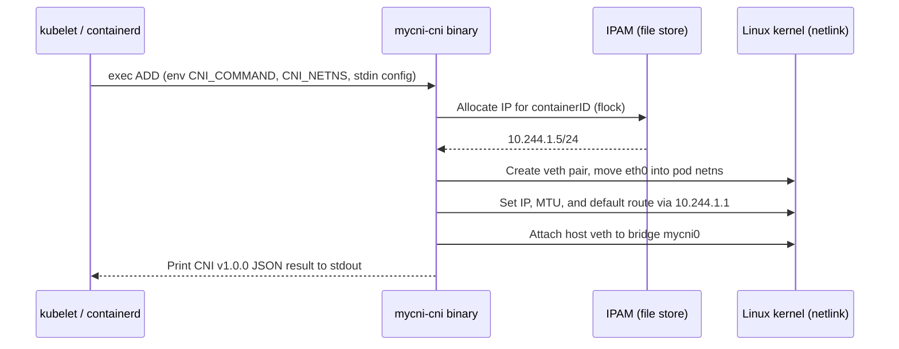
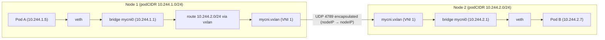
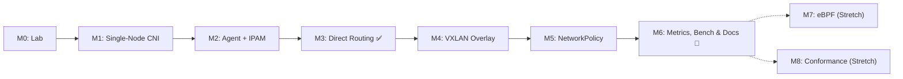

# MyCNI: Project Plan

> **MyCNI** is a Kubernetes CNI plugin written from scratch in Go. It provisions pod network namespaces with veth interfaces, allocates IP addresses per node, connects pods across nodes using either direct routing or a VXLAN overlay, enforces Kubernetes `NetworkPolicy`, and exposes node-level Prometheus metrics.

- **Goal:** Build a project you can demo live, explain down to the packet header, and back up with benchmarks in a Cisco interview—without spending months on it.
- **Time budget:** ~**3 weeks for the core project** (M0–M6) at 3–4 hours/day. Stretch goals (M7 and M8) are optional.
- **Rule:** After **M3**, you already have a complete, working CNI you can put on your resume. Everything after that compounds its impact.

---

## Table of Contents

1. [Why This Project Fits Cisco](#1-why-this-project-fits-cisco)
2. [What You'll Build (Architecture)](#2-what-youll-build-architecture)
3. [Tech Stack & Environment](#3-tech-stack--environment)
4. [Repository Layout](#4-repository-layout)
5. [Milestones](#5-milestones)
6. [Workflow & Anti-Stuck Rules](#6-workflow--anti-stuck-rules)
7. [Testing Strategy](#7-testing-strategy)
8. [Benchmarks](#8-benchmarks)
9. [Final Deliverables Checklist](#9-final-deliverables-checklist)
10. [Resume Bullets](#10-resume-bullets)
11. [Interview Prep: Questions You Must Be Able to Answer](#11-interview-prep-questions-you-must-be-able-to-answer)
12. [Reference Material](#12-reference-material)

---

## 1. Why This Project Fits Cisco

- **Strategic alignment:** Cisco acquired **Isovalent** (the creators of **Cilium**), making Kubernetes networking and dataplane engineering a core focus area across Cisco's cloud and networking teams.
- **Covers core networking fundamentals:** Building a CNI exercises the exact L2–L4 concepts Cisco interviews test—L2 bridging, ARP, L3 routing, overlay encapsulation (VXLAN), MTU/PMTUD, NAT (`conntrack`), and packet filtering—applied directly to Linux containers.
- **High signal, low saturation:** Most candidates have *used* a CNI; very few have built one from the CNI specification up.
- **Concrete, verifiable output:** Pods ping across nodes, `NetworkPolicy` drops unauthorized packets, Wireshark captures show VXLAN headers, and `iperf3` benchmarks quantify encapsulation overhead.

---

## 2. What You'll Build (Architecture)

### Components

| Component | Type | Responsibility |
| --- | --- | --- |
| `mycni-cni` | Short-lived binary (invoked by kubelet/containerd) | Handles CNI `ADD`, `DEL`, `CHECK`, and `VERSION`. Creates the veth pair, moves the container end into the pod netns, assigns the IP and routes, and attaches the host end to the bridge. |
| `pkg/ipam` | Internal Go package | Allocates pod IPs from the node's `spec.podCIDR` and persists leases on disk with `flock` file locking. |
| `mycni-agent` | Long-running DaemonSet | Installs the `mycni-cni` binary and CNI config on each node, initializes the local bridge and NAT rules, programs peer routes or VXLAN tunnels, reconciles `NetworkPolicy` via iptables/ipset, and serves `/metrics`. |
| `mycnictl` | Debugging CLI | Inspects local IPAM leases, peer nodes, programmed kernel routes/FDB entries, and active policy chains. |

### Control Flow (`ADD` Lifecycle)



### Data Path (Cross-Node, VXLAN Mode)



### Design Decisions (For `docs/design.md`)

| Decision | Choice | Rationale |
| --- | --- | --- |
| Same-node connectivity | Linux **bridge** (`mycni0`) + veth pairs | Clean L2 domain per node; easy to inspect with standard `ip` and `bridge` tools; matches the reference CNI `bridge` plugin. |
| Cross-node connectivity | **Direct routing** first, then **VXLAN** | Direct routing takes ~20 lines of netlink code and gets M3 shippable fast; VXLAN demonstrates L2-over-L3 encapsulation, ARP/FDB programming, and MTU trade-offs. |
| IPAM | Node's `spec.podCIDR` + file-backed leases | Kubernetes `kube-controller-manager` automatically carves a `/24` per node; local file locking (`flock`) avoids needing a cluster-wide datastore. |
| Plugin ↔ Agent IPC | **None** in core project | `mycni-cni` reads the static config written by `mycni-agent` and manages local IPAM directly. Avoids gRPC socket lifecycle bugs during pod sandboxing. |
| Policy engine | **iptables** (`coreos/go-iptables`) + **ipset** | Well-documented, atomic updates via `iptables-restore --noflush`, O(1) IP set lookups via `ipset`. eBPF is scoped as a stretch goal (M7). |
| Pod MTU | `1450` in VXLAN mode, `1500` in direct mode | VXLAN adds 50 bytes of outer headers (14B inner Ethernet + 8B VXLAN + 8B UDP + 20B outer IPv4). Great interview talking point. |

---

## 3. Tech Stack & Environment

### Go Libraries

| Purpose | Package |
| --- | --- |
| CNI skeleton & result types | `github.com/containernetworking/cni/pkg/skel`, `pkg/types/100`, `pkg/version` |
| Netns, veth, and IP helpers | `github.com/containernetworking/plugins/pkg/ns`, `pkg/ip` |
| Netlink (links, addrs, routes, neigh, FDB) | `github.com/vishvananda/netlink` |
| Kubernetes API & Informers | `k8s.io/client-go`, `k8s.io/apimachinery` |
| iptables management | `github.com/coreos/go-iptables/iptables` |
| Prometheus metrics | `github.com/prometheus/client_golang/prometheus` |
| Structured logging | `log/slog` (Go standard library) |
| CLI framework | `github.com/spf13/cobra` |

### Local Environment

- **Runtime:** `colima` (Linux VM) + `docker` + `kind` + `kubectl`
- **Build:** Cross-compile on macOS with `CGO_ENABLED=0 GOOS=linux GOARCH=$(go env GOARCH)`
- **Cluster topology:** 1 control-plane node + 2 worker nodes, with the default CNI disabled:

```yaml
# deploy/kind-config.yaml
kind: Cluster
apiVersion: kind.x-k8s.io/v1alpha4
networking:
  disableDefaultCNI: true      # Nodes stay NotReady until MyCNI is installed
  podSubnet: "10.244.0.0/16"   # kube-controller-manager allocates a /24 per node
nodes:
  - role: control-plane
  - role: worker
  - role: worker
```

### Node Debugging Toolkit (Practice in M0)

```bash
# Shell into a kind worker node
docker exec -it mycni-worker bash

# Inspect host interfaces, addresses, routes, FDB, and ARP tables
ip -d link show
ip addr show
ip route show
bridge fdb show
ip neigh show

# Find a pod's network namespace and run commands inside it
crictl ps
crictl inspectp <pod-sandbox-id> | grep -A5 namespaces
nsenter --net=/var/run/netns/<ns-id> ip addr show

# Capture traffic on the bridge or VXLAN UDP port
tcpdump -ni mycni0
tcpdump -ni eth0 udp port 4789

# Inspect MyCNI iptables chains and plugin logs
iptables-save | grep MYCNI
cat /var/log/mycni-cni.log
```

---

## 4. Repository Layout

```text
mycni/
├── cmd/
│   ├── mycni-cni/          # CNI plugin binary (main.go: skel.PluginMainFuncs)
│   ├── mycni-agent/        # Node DaemonSet agent
│   └── mycnictl/           # Debugging CLI
├── pkg/
│   ├── cni/                # ADD/DEL/CHECK handlers & CNI config parsing
│   ├── ipam/               # Per-node CIDR allocator + flock file store
│   ├── netutil/            # Bridge, veth, nat, and sysctl helpers
│   ├── routing/            # Backend interface + direct & vxlan implementations
│   ├── policy/             # NetworkPolicy informer → iptables/ipset compiler
│   └── metrics/            # Prometheus collectors
├── deploy/
│   ├── kind-config.yaml    # 3-node kind cluster config (disableDefaultCNI: true)
│   └── mycni.yaml          # Namespace, RBAC, ConfigMap, DaemonSet
├── test/
│   ├── e2e/                # Automated connectivity & NetworkPolicy e2e tests
│   └── manifests/          # Sample workloads and NetworkPolicy fixtures
├── docs/
│   ├── design.md           # Architecture, trade-offs, and limitations
│   ├── packet-walk.md      # Hop-by-hop packet lifecycle (interview script)
│   ├── benchmarks.md       # Throughput, latency, and policy convergence data
│   └── debugging-stories/  # e.g., mtu-blackhole.md, br-netfilter-bypass.md
├── hack/                   # Helper scripts: kind-up.sh, deploy.sh, bench.sh
├── Dockerfile              # Multi-stage build bundling mycni-agent + mycni-cni
├── Makefile                # build, image, kind-load, deploy, test, e2e, bench
└── README.md
```

---

## 5. Milestones

Each milestone defines a **Goal**, **Tasks**, a **Definition of Done (DoD)**, and a **Fallback**. Do not start the next milestone until the current milestone's DoD passes.

| # | Milestone | Est. Time | Cumulative | Resume Value |
| --- | --- | --- | --- | --- |
| **M0** | Environment & manual networking lab | 1 day | Day 1 | — |
| **M1** | Single-node CNI plugin: pods get IPs & ping | 3 days | Day 4 | Low |
| **M2** | DaemonSet agent + automated install + IPAM hardening | 2 days | Day 6 | Medium |
| **M3** | Cross-node connectivity: direct routing | 2 days | Day 8 | **Shippable** ✅ |
| **M4** | Cross-node connectivity: VXLAN overlay | 3 days | Day 11 | High |
| **M5** | Kubernetes `NetworkPolicy` enforcement | 4 days | Day 15 | Very High |
| **M6** | Observability, CLI, benchmarks, and docs | 4 days | Day 19 | **Interview-ready** 🎯 |
| **M7** | *Stretch:* eBPF dataplane component | 3–5 days | — | Exceptional |
| **M8** | *Stretch:* Upstream K8s sig-network conformance | 2–3 days | — | Exceptional |



---

### M0: Environment & Manual Networking Lab (1 Day)

**Goal:** Build a pod-to-pod bridge network manually with `ip` commands so every netlink call in M1 is concrete.

#### M0 Tasks

1. Start Colima (`colima start --cpu 4 --memory 8`) and verify `docker info`.
2. Create the kind cluster (`kind create cluster --name mycni --config deploy/kind-config.yaml`). Confirm all nodes show `NotReady` because no CNI plugin is installed yet.
3. Exec into a worker node (`docker exec -it mycni-worker bash`) and wire two network namespaces manually:

   ```bash
   # Create bridge mycni0 with gateway IP 10.99.0.1/24
   ip link add mycni0 type bridge
   ip addr add 10.99.0.1/24 dev mycni0
   ip link set mycni0 up

   # Create netns podA and connect it to mycni0 via a veth pair
   ip netns add podA
   ip link add vethA type veth peer name eth0 netns podA
   ip link set vethA master mycni0 up
   ip -n podA addr add 10.99.0.5/24 dev eth0
   ip -n podA link set lo up
   ip -n podA link set eth0 up
   ip -n podA route add default via 10.99.0.1

   # Verify podA can ping the bridge gateway
   ip netns exec podA ping -c 1 10.99.0.1
   ```

4. Repeat the steps for `podB` (`10.99.0.6/24`) and ping `podB` from `podA`. Run `tcpdump -ni mycni0` in a second terminal to observe the ARP request/reply followed by ICMP echo packets. Clean up the manual namespaces and bridge afterwards.
5. Read the [CNI Specification v1.0.0](https://github.com/containernetworking/cni/blob/main/SPEC.md), focusing on *Execution of Network Configurations* (`ADD`/`DEL`/`CHECK`) and the *Result* JSON schema.
6. Initialize the Go repository: `go mod init github.com/sanjeevliv/mycni`, scaffold the directory structure, `.gitignore`, `Makefile`, and initial `README.md`.

#### M0 Definition of Done

- [ ] Two manual network namespaces can ping each other through `mycni0`, and you can explain the role of every `ip` command.
- [ ] Repository is initialized with a working `Makefile`.

#### M0 Fallback

- None needed—this milestone uses standard Linux `iproute2` commands.

---

### M1: Single-Node CNI Plugin — Pods on One Node Get IPs (3 Days)

**Goal:** `kubectl run` succeeds on a single node, and two pods scheduled on that node can ping each other and the internet.

#### M1 Tasks

1. **Entrypoint (`cmd/mycni-cni/main.go`):** Wire `skel.PluginMainFuncs(skel.CNIFuncs{Add: cmdAdd, Del: cmdDel, Check: cmdCheck}, version.All, "mycni")`.
2. **Configuration parsing (`pkg/cni`):** Parse the CNI configuration JSON from `stdin`:

   ```json
   {
     "cniVersion": "1.0.0",
     "name": "mycni",
     "type": "mycni-cni",
     "bridge": "mycni0",
     "mtu": 1500,
     "podCIDR": "10.244.1.0/24",
     "dataDir": "/var/lib/cni/mycni"
   }
   ```

   **Note:** Save single-plugin configs as `/etc/cni/net.d/10-mycni.conf`, or wrap in a `"plugins": [...]` array if using `.conflist`.
3. **IPAM (`pkg/ipam`):**
   - Allocate the next available IPv4 address from `podCIDR` (reserving `.0` network, `.1` bridge gateway, and `.255` broadcast).
   - Persist leases in `/var/lib/cni/mycni/` using an exclusive file lock (`syscall.Flock`) so concurrent pod startups never receive duplicate IPs.
4. **`ADD` handler:**
   - Ensure bridge `mycni0` exists, has gateway IP `.1/24`, and is `UP` (idempotent).
   - Inside `ns.WithNetNSPath(args.Netns, ...)`, call `ip.SetupVeth(args.IfName, conf.MTU, "")` to create the veth pair with `eth0` inside the pod and the peer returned on the host.
   - Inside the pod netns: assign the allocated IP/mask to `eth0`, bring `eth0` and `lo` up, and add a default route via the `.1` gateway.
   - On the host: attach the host-side veth interface to `mycni0` and set it `UP`.
   - Enable `net.ipv4.ip_forward=1`.
   - Write a `types100.Result` (interfaces, IPs, routes) to `stdout`.
5. **`DEL` handler:**
   - Release the IP lease associated with `args.ContainerID`.
   - Enter `args.Netns` (if it still exists) and delete `args.IfName`.
   - **Must be idempotent:** if the netns, veth, or IP lease is already gone, return `nil` (exit `0`) per the CNI spec.
6. **`CHECK` handler:** Verify the pod interface exists and holds the expected IP address.
7. **Logging:** Log all operations and errors to `/var/log/mycni-cni.log` (`stdout` must only contain the CNI JSON result).
8. **Manual installation & egress NAT test:**
   - Copy `mycni-cni` into `mycni-worker:/opt/cni/bin/` and `/etc/cni/net.d/10-mycni.conf` with the node's `spec.podCIDR`.
   - Add the egress MASQUERADE rule on the node so pods can reach external IPs:

     ```bash
     iptables -t nat -A POSTROUTING -s 10.244.1.0/24 ! -d 10.244.0.0/16 -j MASQUERADE
     ```

#### M1 Definition of Done

- [ ] `mycni-worker` transitions from `NotReady` to `Ready`.
- [ ] Two pods pinned to `mycni-worker` (`nodeName: mycni-worker`) receive IPs from its `podCIDR` and can ping each other.
- [ ] A pod can reach an external IP/site (validating outbound NAT).
- [ ] Deleting the pods removes their veth interfaces and frees their IPAM lease files.
- [ ] Unit tests pass for IPAM allocation, release, concurrency locking, and pool exhaustion.

#### M1 Fallback

- Inspect the official [`containernetworking/plugins/plugins/main/bridge`](https://github.com/containernetworking/plugins/tree/main/plugins/main/bridge) implementation. Following its netlink call sequence is completely fine as long as you understand every step.

---

### M2: DaemonSet Agent + Automated Install + IPAM Hardening (2 Days)

**Goal:** `kubectl apply -f deploy/mycni.yaml` automatically bootstraps CNI networking across **all** cluster nodes with zero manual setup.

#### M2 Tasks

1. **Node Agent (`cmd/mycni-agent`):**
   - Read `NODE_NAME` from the Downward API and query the Kubernetes API for the local `Node` object to retrieve `spec.podCIDR`.
   - Copy `/bin/mycni-cni` to `/host/opt/cni/bin/mycni-cni` atomically (write to `.tmp` and `os.Rename`).
   - Render `/host/etc/cni/net.d/10-mycni.conf` with the node's `podCIDR`.
   - Initialize `mycni0` and install the idempotent iptables `POSTROUTING` MASQUERADE rule on startup.
   - Ensure required kernel sysctls are enabled: `net.ipv4.ip_forward=1` and `net.bridge.bridge-nf-call-iptables=1` (required for `kube-proxy` Service routing and M5 `NetworkPolicy`).
2. **Kubernetes Manifests (`deploy/mycni.yaml`):**
   - `Namespace` (`kube-system` or `mycni-system`), `ServiceAccount`, `ClusterRole`, and `ClusterRoleBinding` (permissions: `get`/`list`/`watch` on `nodes`, `pods`, `namespaces`, `networkpolicies`; `patch` on `nodes`).
   - `DaemonSet` with `hostNetwork: true`, `privileged: true`, tolerations for `node.kubernetes.io/not-ready` and control-plane taints, and `hostPath` mounts for `/opt/cni/bin`, `/etc/cni/net.d`, `/var/lib/cni/mycni`, `/var/log`, and `/run/xtables.lock`.
3. **Container Packaging & Automation:**
   - Multi-stage `Dockerfile` building both `mycni-agent` and `mycni-cni`.
   - `Makefile` targets: `build`, `image`, `kind-load`, `deploy`, `redeploy`, `logs`.
4. **IPAM Hardening:**
   - Startup garbage collection: reconcile `/var/lib/cni/mycni` lease files against active pods on the node, freeing leaked IPs from crashed sandboxes.
   - Concurrency stress test: schedule a 30-replica `Deployment` and verify zero IP collisions.

#### M2 Definition of Done

- [ ] On a fresh 3-node kind cluster, running `make deploy` turns all 3 nodes `Ready` and brings `coredns` pods to `Running`.
- [ ] Scaling a `Deployment` to 30 replicas assigns 30 unique IPs; scaling to `0` releases all 30 leases.
- [ ] Restarting the agent (`kubectl rollout restart ds/mycni-agent`) does not disrupt running pods.

#### M2 Fallback

- If startup lease GC takes too long, log orphaned leases as a warning and document full GC under Known Limitations. File-locked concurrency (`flock`) is the mandatory requirement.

---

### M3: Cross-Node Connectivity — Direct Routing (2 Days) ✅ Shippable

**Goal:** Any pod on any node can communicate with any pod on any other node, as well as Kubernetes `ClusterIP` Services and CoreDNS.

#### M3 Tasks

1. **Routing Backend Interface (`pkg/routing`):** Define a clean abstraction that M4 will also implement:

   ```go
   type NodeInfo struct {
       Name    string
       NodeIP  net.IP
       PodCIDR *net.IPNet
       VtepMAC net.HardwareAddr
   }

   type Backend interface {
       Name() string
       Init(local NodeInfo) error
       AddPeer(peer NodeInfo) error
       RemovePeer(peer NodeInfo) error
       Reconcile(peers []NodeInfo) error
   }
   ```

2. **Node Watcher:** Use a `client-go` SharedInformer for `v1.Node` events in `mycni-agent`. When a peer node with a valid `spec.podCIDR` and `InternalIP` is added, updated, or deleted, invoke `AddPeer` or `RemovePeer`.
3. **Direct Routing Backend (`pkg/routing/direct`):**
   - For each peer node, program a host route via netlink equivalent to:

     ```bash
     ip route replace <peerPodCIDR> via <peerNodeIP> dev eth0 proto 77
     ```

   - Tag routes installed by MyCNI with a custom route protocol number (`proto 77`) so reconciliation only touches MyCNI-owned routes.
   - Document in `docs/design.md` why direct routing works in `kind` (all nodes share a flat L2 Docker bridge) and when an overlay or BGP is required in production (cross-subnet nodes).
4. **Periodic Reconciler:** Every 30 seconds, diff kernel routes (`proto 77`) against the live peer list—adding missing routes and pruning stale ones.
5. **End-to-End Connectivity Suite (`test/e2e`):**
   - Deploy a daemon/test pod on every node and verify the full $N \times N$ pod-to-pod ping/HTTP matrix.
   - Verify `ClusterIP` Service VIP reachability and `CoreDNS` name resolution (`nslookup kubernetes.default.svc.cluster.local`).

#### M3 Definition of Done

- [ ] All-pairs pod-to-pod connectivity passes across all nodes.
- [ ] `ClusterIP` Services and cluster DNS lookups succeed from any pod.
- [ ] Deleting a worker node automatically cleans up its `podCIDR` route on remaining nodes.
- [ ] `README.md` includes a working one-command quickstart (`make kind-up deploy e2e`).

> [!IMPORTANT]
> **Milestone Checkpoint:** At the end of M3, you have a complete, working Kubernetes CNI plugin. Tag `v0.1.0`, push to GitHub, and add the base bullet to your resume.

#### M3 Fallback

- If `ClusterIP` Services or DNS fail:
  1. Verify `sysctl net.bridge.bridge-nf-call-iptables=1` (load `modprobe br_netfilter` in the Colima VM if missing).
  2. Confirm the NAT `MASQUERADE` rule excludes `-d 10.244.0.0/16`.
  3. Trace packets with `tcpdump -ni mycni0` and `tcpdump -ni eth0`.

---

### M4: Cross-Node Connectivity — VXLAN Overlay (3 Days)

**Goal:** Support cross-node pod networking over an L2-over-UDP VXLAN overlay tunnel, selectable via `--backend=vxlan`.

#### M4 Tasks

1. **VTEP Initialization (`pkg/routing/vxlan`):**
   - Create VXLAN link `mycni.vxlan` with `Vni: 1`, `Port: 4789` (IANA VXLAN port), `SrcAddr: <localNodeIP>`, `VtepDevIndex: <eth0>`, and `Learning: false` (`nolearning`).
   - Assign `<localPodCIDR.IP>/32` (e.g., `10.244.1.0/32`, Flannel's VTEP convention) to `mycni.vxlan` and bring the link `UP`.
2. **VTEP MAC Exchange:**
   - Have `mycni-agent` patch its own `Node` annotations with `mycni.io/vtep-mac: <mycni.vxlan hardware addr>`.
   - Peer agents read `mycni.io/vtep-mac` from the Node informer.
3. **Peer Programming (`AddPeer`):** Program three kernel entries per remote node via `netlink`:

   | Kernel Subsystem | `iproute2` Equivalent | Purpose |
   | --- | --- | --- |
   | **Routing table** | `ip route replace 10.244.2.0/24 via 10.244.2.0 dev mycni.vxlan onlink proto 77` | Directs traffic destined for the remote `podCIDR` into `mycni.vxlan`. |
   | **Neighbor (ARP) table** | `ip neigh replace 10.244.2.0 lladdr <peerVtepMAC> dev mycni.vxlan nud permanent` | Resolves next-hop `10.244.2.0` to the remote VTEP's MAC without ARP broadcast flooding. |
   | **Bridge FDB** | `bridge fdb replace <peerVtepMAC> dev mycni.vxlan dst <peerNodeIP>` | Tells the VXLAN driver which underlay `peerNodeIP` to encapsulate UDP packets toward. |

4. **MTU Handling & Debugging Story:**
   - Have `mycni-agent` automatically configure `mtu: 1450` in `/etc/cni/net.d/10-mycni.conf` when `--backend=vxlan` is active (accounting for the 50-byte VXLAN encapsulation overhead).
   - Deliberately test with `mtu: 1500` first, reproduce a stalled large HTTP response while `ping` still works, capture it with `tcpdump`, and write up `docs/debugging-stories/mtu-blackhole.md`.
5. **Packet Capture Verification:**
   - Capture cross-node traffic with `tcpdump -ni eth0 udp port 4789 -w vxlan.pcap`.
   - Inspect in Wireshark and save an annotated screenshot showing Outer Ethernet → Outer IPv4 (Node1 → Node2) → Outer UDP (dst 4789) → VXLAN (VNI 1) → Inner Ethernet → Inner IPv4 (PodA → PodB).

#### M4 Definition of Done

- [ ] Full $N \times N$ e2e connectivity suite passes with `--backend=vxlan` and `--backend=direct`.
- [ ] Annotated Wireshark screenshot committed to `docs/`.
- [ ] `docs/debugging-stories/mtu-blackhole.md` written with root cause (50B header + DF bit + PMTUD blackhole) and fix.

#### M4 Fallback

- Prototype the three `ip route` / `ip neigh` / `bridge fdb` commands manually in a shell on two `kind` nodes first. Once cross-node `ping` works in bash, translate the exact parameters to `vishvananda/netlink` calls (see Flannel's [`pkg/backend/vxlan`](https://github.com/flannel-io/flannel/tree/master/pkg/backend/vxlan) for reference).

---

### M5: Kubernetes `NetworkPolicy` Enforcement (4 Days)

**Goal:** Standard `networking.k8s.io/v1` `NetworkPolicy` resources dynamically filter ingress traffic to selected pods.

#### Supported Spec Scope

Keep the scope focused and explicitly document unsupported fields:

| Feature | Core (M5) | Stretch |
| --- | --- | --- |
| `policyTypes: [Ingress]` | ✅ | — |
| `podSelector` (`matchLabels`) | ✅ | `matchExpressions` |
| `ingress.from.podSelector` | ✅ | — |
| `ingress.from.namespaceSelector` | ✅ | — |
| `ingress.ports` (TCP/UDP port numbers) | ✅ | Named ports, port ranges |
| Default deny (empty `ingress: []`) | ✅ | — |
| `ingress.from.ipBlock` | — | ✅ |
| `policyTypes: [Egress]` | — | ✅ |

#### M5 Tasks

1. **Informers:** Watch `Pods`, `Namespaces`, and `NetworkPolicies` in `mycni-agent`.
2. **Policy Compiler (`pkg/policy`):**
   - Write a pure-Go translator (zero kernel dependencies so it is 100% unit-testable):
     `Compile(localNode string, pods []*v1.Pod, namespaces []*v1.Namespace, policies []*networkingv1.NetworkPolicy) []PodPolicy`
3. **Dataplane Programming (`iptables` + `ipset`):**
   - Create top-level chain `MYCNI-FORWARD` and insert a jump from `filter/FORWARD` (`-j MYCNI-FORWARD`).
   - Allow established return traffic at the top of `MYCNI-FORWARD`: `-m conntrack --ctstate ESTABLISHED,RELATED -j ACCEPT`.
   - For each local pod selected by at least one `NetworkPolicy`:
     - Create chain `MYCNI-POD-<short-hash>` and jump to it when `-d <podIP>`.
     - Program allowed source pod IPs into an `ipset` (`hash:ip`) and match with `-m set --match-set <set-name> src -p tcp --dport <port> -j ACCEPT`.
     - Append a final `-j DROP` at the end of `MYCNI-POD-<short-hash>` (enforcing default-deny for unmatched ingress traffic).
   - Pods not selected by any `NetworkPolicy` are untouched (default-allow per Kubernetes semantics).
4. **Atomic Reconciliation:**
   - Debounce informer events (e.g., 250–500ms) and apply updates atomically via `iptables-restore --noflush` for `MYCNI-*` chains only.
5. **Same-Node Bridged Traffic (`br_netfilter`):**
   - Same-node pod-to-pod packets traverse `mycni0` at L2 and bypass `iptables` `FORWARD` unless `br_netfilter` is loaded and `net.bridge.bridge-nf-call-iptables=1` is set. Document this in `docs/debugging-stories/br-netfilter-bypass.md`.
6. **End-to-End Policy Tests (`test/e2e`):**
   - Implement 6 automated scenarios: (1) Default deny ingress, (2) Allow by `podSelector`, (3) Allow by `namespaceSelector`, (4) Allow specific TCP port only, (5) Same-node vs. cross-node enforcement parity, (6) Policy deletion restores connectivity.

#### M5 Definition of Done

- [ ] All 6 e2e `NetworkPolicy` scenarios pass on both `direct` and `vxlan` backends.
- [ ] Unit tests cover the policy compiler across selector combinations.
- [ ] Policy convergence latency (time from `kubectl apply` to packet drop) is measured and under 2 seconds.

#### M5 Fallback

- Implement `iptables` source-IP rules directly before introducing `ipset`, or scope to `podSelector` + `ports` first before adding `namespaceSelector`.

---

### M6: Observability, CLI, Benchmarks, and Docs (4 Days) 🎯 Interview-Ready

**Goal:** Polish MyCNI with production-style telemetry, a diagnostic CLI, reproducible benchmarks, and interview-ready documentation.

#### M6 Tasks

1. **Prometheus Metrics (`:9090/metrics` on `mycni-agent`):**
   - `mycni_ipam_allocated_ips` (Gauge), `mycni_ipam_capacity_ips` (Gauge)
   - `mycni_routing_peers_total` (Gauge), `mycni_routing_reconcile_duration_seconds` (Histogram), `mycni_routing_reconcile_errors_total` (Counter)
   - `mycni_policy_active_chains` (Gauge), `mycni_policy_sync_duration_seconds` (Histogram)
   - `mycni_cni_operation_duration_seconds{operation="ADD|DEL"}` (Histogram, populated via a lightweight local log/metric file written by `mycni-cni`)
   - Per-pod interface counters (`rx_bytes`, `tx_bytes`, `rx_dropped`, `tx_dropped`) scraped from `/sys/class/net/<veth>/statistics/`.
2. **Diagnostic CLI (`cmd/mycnictl`):**
   - Subcommands: `mycnictl status`, `mycnictl leases`, `mycnictl peers`, `mycnictl routes`, `mycnictl policy`.
   - Reads local state on the node or queries a lightweight read-only debug endpoint on `mycni-agent`.
3. **Benchmarks (`hack/bench.sh` & `docs/benchmarks.md`):**
   - Automate the benchmark suite described in [Section 8](#8-benchmarks) and chart the results.
4. **Documentation:**
   - `README.md`: 1-line summary, architecture diagram, 60-second terminal demo GIF (`vhs` or `asciinema`), quickstart, feature matrix, and known limitations.
   - `docs/design.md`: Component architecture, design decisions table, and production scaling trade-offs.
   - `docs/packet-walk.md`: Step-by-step walkthrough of a packet traveling from `Pod A` on Node 1 to `Pod B` on Node 2 (every interface, netns boundary, routing lookup, ARP/FDB resolution, and header change). **This serves as your verbal interview script.**
   - `docs/debugging-stories/`: `mtu-blackhole.md` and `br-netfilter-bypass.md`.
5. **CI Pipeline (`.github/workflows/ci.yml`):**
   - Run `go vet`, `golangci-lint`, unit tests, build images, spin up a 3-node `kind` cluster on the GitHub Actions runner, and run the e2e connectivity and policy test suites.

#### M6 Definition of Done

- [ ] GitHub Actions CI badge is green (unit tests + multi-node `kind` e2e).
- [ ] `docs/benchmarks.md` published with median numbers across 5 runs.
- [ ] You can explain the full cross-node packet walk (`docs/packet-walk.md`) out loud in 3 minutes without notes.

---

### M7: *Stretch* — eBPF Dataplane Component (3–5 Days)

Pick **one** targeted eBPF feature rather than rewriting the entire dataplane:

| Option | Description | Complexity |
| --- | --- | --- |
| **Option A: eBPF Per-Flow Telemetry (Recommended)** | Attach a `tc` (`sched_cls`) ingress/egress program to each host-side veth interface using `cilium/ebpf` + `bpf2go`. Count packets and bytes per 5-tuple (`srcIP`, `dstIP`, `srcPort`, `dstPort`, `proto`) in an LRU BPF hash map and export top flows via `mycnictl flows` and Prometheus. | Medium |
| **Option B: eBPF Ingress Policy Filter** | Enforce M5 pod ingress filtering using a `tc` eBPF program backed by a per-pod BPF LPM/hash map instead of `iptables`, and benchmark throughput/latency against `iptables` at 100+ policies. | Hard |

- **Why it matters:** eBPF is the core technology powering Cilium (Cisco/Isovalent). Even a focused, working `cilium/ebpf` component sets your project apart.
- **Prerequisite:** Verify `uname -r` inside Colima is $\ge 5.10$ and include `clang`/`llvm` in the builder stage of your `Dockerfile`.
- **Fallback if stuck:** Timebox to 2 days. If blocked by verifier errors, keep the `M0–M6` release clean and document the eBPF prototype in a separate branch.

---

### M8: *Stretch* — Upstream Kubernetes Networking Conformance (2–3 Days)

Run the official upstream Kubernetes `sig-network` conformance test binary against a `kind` cluster running MyCNI:

```bash
# Run upstream sig-network pod networking checks
./e2e.test --kubeconfig ~/.kube/config \
  --ginkgo.focus='\[sig-network\].*Networking.*Granular Checks: Pods' \
  --ginkgo.skip='Feature|Disruptive|Serial|IPv6'
```

- **Why it matters:** Being able to state *"Passes upstream Kubernetes sig-network pod connectivity conformance tests"* on your resume is a strong credibility marker.
- **Fallback if stuck:** Document the exact subset of conformance specs executed and passed, and note unsupported features (such as IPv6 dual-stack).

---

## 6. Workflow & Anti-Stuck Rules

1. **4-Hour Timebox:** If a single bug blocks you for **more than 4 hours**, switch to the milestone's documented fallback, log the trade-off under *Known Limitations* in `README.md`, and keep moving. Interviewers respect well-reasoned scope management.
2. **Shell First, Go Second:** Always prototype kernel changes using `ip`, `bridge`, and `iptables` CLI commands inside a `kind` node first. Once packets flow, translate the exact flags into `netlink` Go code.
3. **Use Reference Implementations Wisely:** `containernetworking/plugins` (`bridge`, `host-local`), `flannel` (`pkg/backend/vxlan`), and `kindnet` solve these exact problems. Read them whenever netlink struct fields are unclear.
4. **Avoid Scope Creep:** No plugin-to-agent gRPC daemon, no custom CRDs, no Helm chart, no IPv6, and no BGP in the core M0–M6 plan. List those under *Future Work*.
5. **Tag Every Milestone:** Tag `v0.1.0` (M3), `v0.2.0` (M4), `v0.3.0` (M5), and `v1.0.0` (M6).
6. **Systematic Debugging Order:**
   1. `/var/log/mycni-cni.log` and `kubectl logs -n kube-system ds/mycni-agent`
   2. `kubectl describe pod <pod>` (kubelet sandbox events)
   3. `ip addr`, `ip route`, `ip neigh`, `bridge fdb show` on both source and destination nodes
   4. `tcpdump` hop-by-hop (`veth` → `mycni0` → `mycni.vxlan` → node `eth0`)
7. **Cluster Rebuilds Are Cheap:** `kind delete cluster --name mycni && make kind-up deploy` takes ~60 seconds. Never waste an hour repairing a broken test cluster.

### Suggested Daily Rhythm (3–4 Hours/Day)

| Time Allocation | Activity |
| --- | --- |
| **30 min** | Read the CNI spec, man pages (`man ip-link`, `man iptables`), or reference plugin code for today's task. |
| **2–2.5 hrs** | Prototype kernel commands in a `kind` node shell, then implement in Go and run tests. |
| **30 min** | Update docs, record debugging notes while fresh, commit, and check off DoD items. |

### Common Pitfalls & Quick Fixes

| Symptom | Root Cause & Fix |
| --- | --- |
| Node stays `NotReady` | Missing/invalid config in `/etc/cni/net.d/10-mycni.conf` (watch `.conf` vs `.conflist` format!) or `/opt/cni/bin/mycni-cni` is not `chmod +x`. |
| Pod stuck in `ContainerCreating` | `mycni-cni` returned non-zero or printed non-JSON logs to `stdout`. Check `kubectl describe pod` and `/var/log/mycni-cni.log`. |
| Pod stuck in `Terminating` | `DEL` handler returned an error on an already-deleted interface/netns. Ensure `DEL` is strictly idempotent. |
| Duplicate pod IPs under load | Missing `syscall.Flock` around IPAM read-allocate-write critical section. |
| Same-node ping works, cross-node fails | Asymmetric route, missing static ARP (`ip neigh`), or missing `bridge fdb` entry on one of the two nodes. Check both directions. |
| `ping` works, large HTTP transfers hang | VXLAN 50-byte header exceeds 1500B underlay MTU with `DF=1`. Set pod MTU to `1450`. |
| `ClusterIP` Services or DNS time out | `net.bridge.bridge-nf-call-iptables=0` or NAT `MASQUERADE` rule is SNATing internal `10.244.0.0/16` traffic. |
| `NetworkPolicy` ignored for same-node pods | `br_netfilter` kernel module not loaded (`modprobe br_netfilter` inside the Colima VM). |
| `iptables` rules vanish unexpectedly | Only manage custom `MYCNI-*` chains via `iptables-restore --noflush`; never flush built-in chains used by `kube-proxy`. |

---

## 7. Testing Strategy

| Test Layer | Scope | Execution Environment |
| --- | --- | --- |
| **Unit Tests** | IPAM allocator & locking, CNI config parser, `NetworkPolicy` compiler, route/FDB diff logic | `go test -race ./...` on macOS (no root or Linux kernel required; keep netlink behind interfaces). |
| **Netns Integration** | Veth creation, bridge attachment, VXLAN link setup, idempotent `ADD`/`DEL` | `go test -tags=integration ./...` inside a privileged Linux container (`docker run --privileged`). |
| **E2E Connectivity** | $N \times N$ pod ping/HTTP matrix, `ClusterIP` Services, CoreDNS, external egress | 3-node `kind` cluster (`make e2e` against both `direct` and `vxlan` backends). |
| **E2E NetworkPolicy** | 6 ingress policy scenarios (default deny, pod/namespace selectors, ports, deletion) | 3-node `kind` cluster. |
| **Resilience / Churn** | Agent restart, node deletion, rapid 30-pod scale-up/down | Scripted check verifying zero leaked IP leases or orphaned kernel routes. |
| **Conformance (M8)** | Upstream Kubernetes `sig-network` pod connectivity suite | `e2e.test` / `sonobuoy`. |

---

## 8. Benchmarks

Run all benchmarks on the 3-node `kind` cluster and report the **median of 5 runs**:

| Benchmark | Tool | Comparison |
| --- | --- | --- |
| Same-node pod-to-pod TCP throughput | `iperf3` | MyCNI vs. `kindnet` (kind default) |
| Cross-node pod-to-pod TCP throughput | `iperf3` | MyCNI (`direct`) vs. MyCNI (`vxlan`) vs. Flannel (`vxlan`) |
| Request/response latency (p50 / p99) | `netperf` (`TCP_RR`) or `fortio` | MyCNI (`direct`) vs. MyCNI (`vxlan`) |
| Pod startup / CNI `ADD` latency | 50-pod burst (`mycni_cni_operation_duration_seconds`) | MyCNI vs. `kindnet` |
| Policy convergence latency | Time from `kubectl apply -f policy.yaml` to first blocked packet | MyCNI (`iptables` + `ipset`) |
| *(M7-B)* Policy dataplane scaling | Throughput & latency with 100 active policies | MyCNI (`iptables`) vs. MyCNI (`eBPF tc`) |

> [!NOTE]
> Because `kind` runs all nodes as containers inside a single Linux VM, absolute Gbps numbers reflect local virtual interfaces rather than physical NICs. Emphasize **relative comparisons** in `docs/benchmarks.md`—such as the percentage throughput reduction and CPU cost of VXLAN encapsulation vs. direct routing—which demonstrates strong performance engineering judgment.

---

## 9. Final Deliverables Checklist

- [ ] Public GitHub repository `mycni` with MIT License and green GitHub Actions CI badge (unit + `kind` e2e)
- [ ] Polished `README.md` with one-line pitch, terminal demo GIF, Mermaid architecture diagrams, quickstart, feature matrix, and limitations
- [ ] Technical docs: `docs/design.md`, `docs/packet-walk.md`, and `docs/benchmarks.md`
- [ ] At least 2 deep-dive postmortems in `docs/debugging-stories/` (`mtu-blackhole.md`, `br-netfilter-bypass.md`)
- [ ] Annotated Wireshark VXLAN packet capture screenshot in `docs/`
- [ ] Tagged releases (`v0.1.0` → `v1.0.0`) and multi-arch container image published to GHCR
- [ ] *(Optional)* Technical blog post on `sanjeevsethi.in`: *"Building a Kubernetes CNI from Scratch in Go: Follow the Packet"*
- [ ] Portfolio website and resume updated with MyCNI

---

## 10. Resume Bullets

Select 2–3 bullets based on completed milestones and fill in your measured benchmark numbers:

- **MyCNI — Kubernetes CNI Plugin (Go, Linux Netlink, VXLAN, iptables, eBPF):** Designed and built a CNI v1.0-compliant container networking plugin and node DaemonSet from scratch, provisioning pod network namespaces, veth pairs, Linux bridges, concurrency-safe per-node IPAM (`flock`), and cross-node routing via L3 direct routes or an L2-over-UDP **VXLAN overlay** (static ARP/FDB programming via netlink).
- Implemented Kubernetes **NetworkPolicy** ingress enforcement (`podSelector`, `namespaceSelector`, L4 ports, default-deny) by compiling API watch events into atomic `iptables` and `ipset` (`hash:ip`) dataplane rules with sub-**X s** policy convergence.
- Benchmarked dataplane performance against Flannel and `kindnet` across multi-node `kind` clusters using `iperf3` and `netperf`, quantifying **X%** VXLAN encapsulation overhead and resolving a 1500B PMTUD blackhole caused by 50-byte VXLAN headers.
- *(If M7 completed)* Engineered a **tc eBPF** flow-telemetry program (`cilium/ebpf`) attached to host veth interfaces to track per-5-tuple packet/byte counters in BPF maps and export Prometheus metrics.
- *(If M8 completed)* Validated compliance against upstream Kubernetes **sig-network** pod networking conformance tests in automated GitHub Actions CI.

---

## 11. Interview Prep: Questions You Must Be Able to Answer

### CNI & Kubernetes Architecture

1. Walk through everything that happens from `kubectl run nginx` to the pod having a routable IP address. Which component invokes `mycni-cni`, how is configuration passed, and what environment variables are set?
2. What are the four CNI specification operations (`ADD`, `DEL`, `CHECK`, `VERSION`), and why must `DEL` be strictly idempotent?
3. How does `spec.podCIDR` get assigned to each `Node`? What happens when a node's `/24` IP pool is exhausted, and how do production CNIs (e.g., Cilium cluster-pool or Calico IPAM blocks) improve on fixed per-node CIDRs?
4. How do Kubernetes `ClusterIP` Services work, and where is the boundary of responsibility between `kube-proxy` and the CNI plugin?

### Linux Networking Fundamentals (Core Cisco Topics)

1. Trace a packet hop-by-hop from `Pod A` (`10.244.1.5`) on Node 1 to `Pod B` (`10.244.2.7`) on Node 2 in both Direct Routing and VXLAN modes. Name every interface, lookup table (routing, ARP/neighbor, bridge FDB), and header transformation.
2. What headers does VXLAN prepend to an inner Ethernet frame? Why does VXLAN encapsulate inside UDP (port 4789), how is the UDP source port chosen (ECMP hashing), and what are a VNI and a VTEP?
3. Why must the pod MTU be lowered from `1500` to `1450` in VXLAN mode? How does Path MTU Discovery (PMTUD) work, and why do ICMP Fragmentation Needed (`Type 3, Code 4`) blackholes happen?
4. Compare L3 direct routing vs. VXLAN overlay vs. BGP unnumbered/peered routing (Calico/Cilium native routing): when would you choose each?
5. Why did MyCNI disable MAC learning (`nolearning`) on `mycni.vxlan` and populate static neighbor/FDB entries from the Kubernetes API instead of using multicast flood-and-learn or BGP EVPN?
6. Compare bridged pod networking (`veth` → `mycni0` bridge) vs. pure L3 routed veth networking (Calico-style `/32` host routes + proxy ARP).
7. How does outbound SNAT (`MASQUERADE`) work for pod-to-internet traffic, and how does `conntrack` de-NAT return packets back to the pod IP?

### NetworkPolicy, Scale & eBPF

1. How do you translate Kubernetes label selectors (`podSelector`, `namespaceSelector`) into kernel dataplane rules? Why use `ipset` (`O(1)` hash lookup) instead of generating one `iptables` rule per source/destination pod pair (`O(N)` linear scan)?
2. Why does same-node pod-to-pod traffic bypass `iptables` `FORWARD` chains unless `br_netfilter` and `net.bridge.bridge-nf-call-iptables=1` are enabled?
3. Compare `iptables` vs. `nftables` vs. `eBPF` for Kubernetes policy and service load-balancing. Why did Cilium replace `iptables` with eBPF?
4. What is the difference between `XDP` and `tc` (`sched_cls`) eBPF hooks, and why are `tc` hooks typically used on container veth interfaces?

### Engineering Judgment & Production Readiness

1. What would it take to make MyCNI production-ready? *(Dual-stack IPv4/IPv6, dynamic IPAM block borrowing, BGP control plane, WireGuard/IPsec transparent encryption, egress `NetworkPolicy`, CNI `DEL` crash recovery, and scale testing at 1,000+ nodes).*
2. What was the hardest networking bug you hit while building MyCNI, and how did you isolate it? *(Walk through your `mtu-blackhole.md` or `br-netfilter-bypass.md` debugging story).*

---

## 12. Reference Material

| Topic | Resource |
| --- | --- |
| CNI Specification v1.0.0 | [github.com/containernetworking/cni/blob/main/SPEC.md](https://github.com/containernetworking/cni/blob/main/SPEC.md) |
| Reference CNI Plugins (`bridge`, `host-local`, `ptp`) | [github.com/containernetworking/plugins](https://github.com/containernetworking/plugins) |
| Flannel VXLAN Backend Reference | [github.com/flannel-io/flannel/tree/master/pkg/backend/vxlan](https://github.com/flannel-io/flannel/tree/master/pkg/backend/vxlan) |
| Minimal CNI + Node Agent Reference (`kindnet`) | [github.com/kubernetes-sigs/kindnet](https://github.com/kubernetes-sigs/kindnet) |
| Go Netlink Library | [github.com/vishvananda/netlink](https://github.com/vishvananda/netlink) |
| eBPF in Go (`cilium/ebpf`) | [github.com/cilium/ebpf](https://github.com/cilium/ebpf) |
| Kubernetes `NetworkPolicy` Semantics | [kubernetes.io/docs/concepts/services-networking/network-policies](https://kubernetes.io/docs/concepts/services-networking/network-policies/) |
| `kind` (Kubernetes in Docker) | [kind.sigs.k8s.io](https://kind.sigs.k8s.io/) |
| VXLAN Specification | [RFC 7348](https://datatracker.ietf.org/doc/html/rfc7348) |
