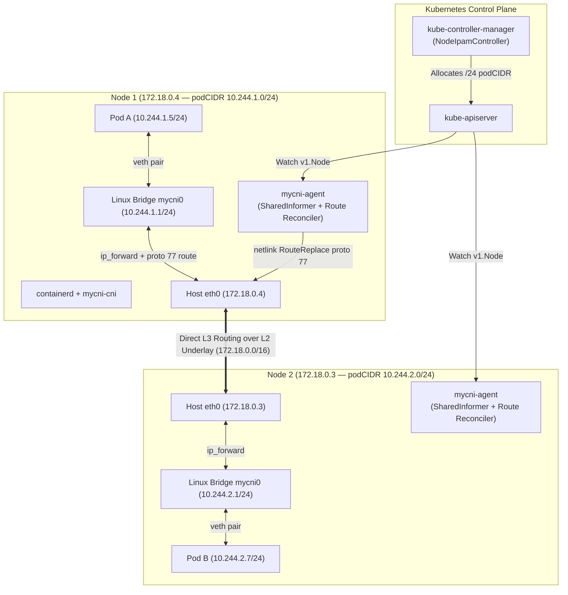

# MyCNI Architecture & Design Specification

**MyCNI** is a CNI v1.0.0 compliant Kubernetes networking plugin and node daemon built from scratch in Go. It implements per-node IP address management (`pkg/ipam`), Linux bridge and veth dataplane wiring (`pkg/netutil`), and cross-node pod routing (`pkg/routing`).

---

## 1. System Architecture

MyCNI splits its control plane and data plane across two binaries packaged in a single container image:

| Component | Binary / Package | Execution Model | Responsibilities |
| --- | --- | --- | --- |
| **CNI Plugin** | `cmd/mycni-cni` | Short-lived binary invoked per pod sandbox event by `containerd` | Implements CNI `ADD`, `DEL`, `CHECK`, and `VERSION`. Allocates pod IPs via file-locked IPAM, creates veth pairs across host and pod network namespaces, configures `eth0` and default routes inside the pod, and attaches the host veth to `mycni0`. |
| **Node Agent** | `cmd/mycni-agent` (`pkg/agent`) | Long-running Kubernetes `DaemonSet` (`hostNetwork: true`, `privileged: true`) | Discovers local `spec.podCIDR` via the Downward API and `client-go`, atomically installs `/opt/cni/bin/mycni-cni` and `/etc/cni/net.d/10-mycni.conf`, initializes `mycni0` and outbound NAT rules, watches cluster `Node` objects to program cross-node routes, and garbage-collects leaked IPAM leases. |
| **IPAM Engine** | `pkg/ipam` | Library shared by `mycni-cni` and `mycni-agent` | Carves IPv4 leases out of the node's `/24` `podCIDR` using `syscall.Flock` mutual exclusion and reconciles lease files against active pods. |
| **Routing Engine** | `pkg/routing` (`direct`, `vxlan`) | Pluggable `Backend` interface inside `mycni-agent` | Programs kernel routing tables (`proto 77`) and reconciles peer routes against the live Kubernetes `Node` inventory every 30 seconds. |



---

## 2. Key Design Decisions & Trade-Offs

| Decision | Choice | Rationale |
| --- | --- | --- |
| **Same-node connectivity** | Linux **bridge** (`mycni0`) + veth pairs | Provides a clean L2 broadcast domain per node, matches the reference `containernetworking/plugins` bridge model, and is straightforward to inspect with standard `ip` and `bridge` tools. Bridge port hairpin mode is enabled (`LinkSetHairpin`) so pods can reach `ClusterIP` Services backed by themselves. |
| **Cross-node connectivity** | Pluggable `routing.Backend`: **Direct Routing** (M3) & **VXLAN Overlay** (M4) | Direct routing programs L3 host routes with zero encapsulation overhead (`MTU 1500`). Abstracting `Backend` (`Init`, `AddPeer`, `RemovePeer`, `Reconcile`) allows switching between native L3 routing and VXLAN encapsulation (`MTU 1450`) via `--backend`. |
| **Route ownership tagging** | Custom kernel route protocol **`proto 77`** | Tagging MyCNI-installed routes with `Protocol: 77` isolates them from kernel (`proto kernel`), boot (`proto boot`), or DHCP routes. The periodic reconciler only diffs and prunes routes with `proto 77`, preventing accidental deletion of host default routes. |
| **IPAM architecture** | Node `spec.podCIDR` + `flock` file store | `kube-controller-manager` automatically allocates a disjoint `/24` per node from `10.244.0.0/16`. Persisting leases in `/var/lib/cni/mycni/leases/` guarded by `syscall.Flock` guarantees zero duplicate IPs under burst pod creation without requiring etcd or CRDs. |
| **Plugin ↔ Agent IPC** | **Zero IPC** (decoupled via atomic config & filesystem) | `mycni-cni` reads `/etc/cni/net.d/10-mycni.conf` rendered atomically by `mycni-agent`. Avoiding a gRPC/Unix socket between `mycni-cni` and `mycni-agent` ensures pod sandboxes can still be created and torn down even while `mycni-agent` is restarting. |

---

## 3. Cross-Node Direct Routing Deep Dive

### 3.1 How Direct Routing Works
Every node in the cluster is assigned a `/24` `podCIDR` by `kube-controller-manager` and has a primary host interface (`eth0`) with a `NodeInternalIP`:

| Node | `NodeInternalIP` (`eth0`) | `spec.podCIDR` | Bridge `mycni0` Gateway |
| --- | --- | --- | --- |
| `mycni-control-plane` | `172.18.0.2` | `10.244.0.0/24` | `10.244.0.1/24` |
| `mycni-worker` | `172.18.0.4` | `10.244.1.0/24` | `10.244.1.1/24` |
| `mycni-worker2` | `172.18.0.3` | `10.244.2.0/24` | `10.244.2.1/24` |

In `mycni-agent`, a `client-go` `SharedInformer` watches `v1.Node` objects. Whenever a peer node is added or updated with a valid `spec.podCIDR` and `InternalIP`, `direct.Backend.AddPeer` executes a netlink `RouteReplace` call equivalent to:

```bash
# On mycni-worker (172.18.0.4):
ip route replace 10.244.0.0/24 via 172.18.0.2 dev eth0 proto 77
ip route replace 10.244.2.0/24 via 172.18.0.3 dev eth0 proto 77
```

When a peer node is deleted from the cluster, the informer's `DeleteFunc` invokes `RemovePeer`, deleting its `proto 77` route immediately. Additionally, every 30 seconds `ReconcileRoutes` queries the live node list and diffs it against `ip route show proto 77` via `routing.DiffRoutes`, self-healing any manually deleted or stale routes.

### 3.2 Hop-by-Hop Packet Walk (Pod A on Node 1 → Pod B on Node 2)
When `Pod A` (`10.244.1.5`) on `mycni-worker` sends a packet to `Pod B` (`10.244.2.7`) on `mycni-worker2`:

1. **Pod A Network Namespace:**
   - Destination `10.244.2.7` is outside `10.244.1.0/24`, matching the pod's default route (`default via 10.244.1.1 dev eth0`).
   - Pod A resolves `10.244.1.1` (`mycni0` MAC) via ARP and transmits the frame out its container `eth0` (`veth`).
2. **Node 1 Bridge (`mycni0`) & L3 Forwarding:**
   - The packet exits the host-side `veth` into `mycni0`. Because the destination MAC is `mycni0` itself, the Linux kernel passes the packet up to the IPv4 routing layer (`net.ipv4.ip_forward=1`).
   - Kernel LPM (Longest Prefix Match) lookup matches `10.244.2.0/24 via 172.18.0.3 dev eth0 proto 77`.
   - Because `10.244.2.7` is inside the cluster CIDR (`10.244.0.0/16`), the `POSTROUTING` `MASQUERADE` rule (`-s 10.244.1.0/24 ! -d 10.244.0.0/16 -j MASQUERADE`) is **skipped**, preserving the pod source IP `10.244.1.5`.
3. **Underlay L2 Transit (`eth0` → `eth0`):**
   - Node 1 resolves `172.18.0.3` (`mycni-worker2`'s `eth0` MAC) via ARP on `172.18.0.0/16` and sends the IP packet (`src=10.244.1.5, dst=10.244.2.7`) encapsulated in an Ethernet frame to `mycni-worker2`.
4. **Node 2 Delivery (`eth0` → `mycni0` → Pod B):**
   - `mycni-worker2` receives the packet on `eth0`, consults its routing table, and matches the local connected route `10.244.2.0/24 dev mycni0 proto kernel scope link src 10.244.2.1`.
   - `mycni0` resolves `10.244.2.7` to Pod B's MAC address and forwards the frame through the host-side `veth` into Pod B's `eth0`.

### 3.3 Why Direct Routing Works in `kind` vs. Production Topologies

- **Why it works in `kind` and single-subnet bare-metal racks:**
  In `kind`, every Kubernetes node is a Docker container attached to the same custom Docker bridge network (`kind`, `172.18.0.0/16`). Because all nodes share a **flat L2 broadcast domain**, Node 1 (`172.18.0.4`) can resolve Node 2's (`172.18.0.3`) MAC address directly via ARP and send an Ethernet frame carrying an inner IP header of `10.244.1.5 → 10.244.2.7` without any intermediate L3 router inspecting or dropping the packet.
- **Why Direct Routing fails across L3 subnet boundaries in production:**
  In multi-AZ cloud VPCs (AWS, GCP, Azure) or multi-rack data centers with Top-of-Rack (ToR) L3 switches:
  1. Nodes reside on **different L3 subnets** (e.g., `10.0.1.10/24` in Rack A and `10.0.2.20/24` in Rack B). The Linux kernel rejects `ip route add 10.244.2.0/24 via 10.0.2.20 dev eth0` with `RTNETLINK answers: Network is unreachable` because the next-hop gateway `10.0.2.20` is not directly reachable on the local L2 link.
  2. Even within the same cloud subnet, cloud virtual switches enforce **Source/Destination IP checks** and do not know how to route unannounced overlay CIDRs (`10.244.x.0/24`) unless programmed into the cloud VPC route table.
- **When to use an Overlay (VXLAN/Geneve) vs. BGP in production:**
  - **VXLAN / Geneve Overlay (M4):** Encapsulates the pod-to-pod frame inside an outer UDP/IP packet (`src=Node1_IP, dst=Node2_IP, dport=4789`). Because the outer IP header uses standard routable node IPs, packets traverse arbitrary L3 routers and cloud VPCs seamlessly without network hardware integration, at the cost of a 50-byte header overhead (`MTU 1450`) and encapsulation CPU cycles.
  - **BGP Native Routing (e.g., Calico, Cilium BGP Control Plane):** Each node runs a BGP speaker (FRR/BIRD) that peers with ToR routers and announces its local `podCIDR` (`10.244.x.0/24`). The physical L3 network fabric learns routes to every pod subnet natively, delivering full line-rate throughput (`MTU 1500`) and direct external routability without encapsulation.

---

## 4. Interaction with `ClusterIP` Services & CoreDNS

Kubernetes Services (`ClusterIP` VIPs in `10.96.0.0/12`) are virtual IPs managed by `kube-proxy` via `iptables` (`PREROUTING` and `OUTPUT` chains in the `nat` table):

1. When a pod queries CoreDNS (`10.96.0.10:53`) or a `ClusterIP` Service, the packet enters `mycni0`.
2. Because `mycni-agent` loads `br_netfilter` and enables `net.bridge.bridge-nf-call-iptables=1`, bridged frames on `mycni0` traverse host netfilter `PREROUTING` chains.
3. `kube-proxy`'s `KUBE-SERVICES` chain intercepts `dst=10.96.0.10:53` and DNATs the destination IP to a backing CoreDNS pod IP (e.g., `10.244.2.3:53` on `mycni-worker2`).
4. If the backing pod is on a remote node, the kernel routes the DNATed packet via the `proto 77` direct route (`10.244.2.0/24 via 172.18.0.3 dev eth0`).
5. If the backing pod is the **same pod** that initiated the request (self-hairpinning), `kube-proxy` marks the packet (`0x4000`) for `KUBE-POSTROUTING` `MASQUERADE`, and `mycni0`'s bridge port hairpin mode (`LinkSetHairpin(hostVeth, true)`) allows the frame to ingress and egress the same bridge port cleanly.
